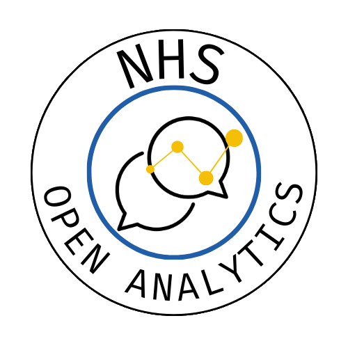

{fig-align="center" height=300}

::: {#hero-heading}
### A community for promoting open code and tools in health and care

Building a community of practice for data analysis and data science using open
source software in the NHS and wider UK health and care system.

:::

## [✨ Virtual Unconference - join us! ✨]() {.plain-link}

In place of an in person conference this year, we are holding a half-day online discussions event ('unconference') Thursday 26th November 9.30-12.30! 
See the [events page](events/virtual_unconference.qmd) for details.

## [Blog](blog/index.qmd) {.plain-link}

::: {#blog}
:::

<a class="browse-more" href="/blog/index.html">
  Browse all blog posts →
</a>

## [Books](books/index.qmd) {.plain-link}

::: {#books}
:::

<a class="browse-more" href="/books/index.html">
  Browse all books →
</a>

::: footer-text
::: {.footer-container .white-background}
::: footer-block
::: grid

::: {.g-col-12 .g-col-md-2}

:::

:::
:::
:::
:::
